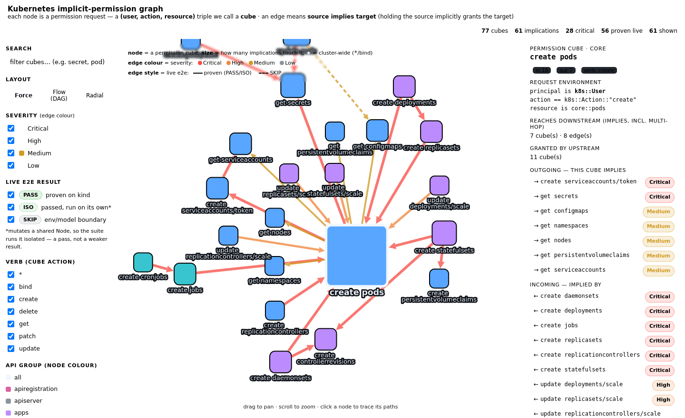

# Implicit-permission graph — permission cubes & implications

An interactive web view of the implicit-permission catalogue in
[`../transitions/`](../transitions): every **permission cube** is a node, and
every **transition** is a directed edge meaning *the source cube implies the
target cube* — holding the source permission implicitly grants the target.

This is the "attack-path graph" the woodpecker design calls for (see the repo
`README.md`, *Soundness and completeness*: a synthesized policy is "for
findings reported to an admin, visualization in an attack path graph, and for
answering 'who can perform action A on resource R?'").

## Open it

`index.html` is self-contained (the graph data is inlined; the only external
loads are Cytoscape.js + dagre from jsdelivr, so it needs network for those
scripts). Just open it:

```sh
xdg-open k8s-transitions/graph/index.html      # or drag into a browser
# or serve on loopback:
python3 -m http.server 8791 --bind 127.0.0.1 --directory k8s-transitions/graph
```

## What a node and an edge are

- **Node = a permission cube**: a `(principal, action, resource)` request
  environment. Every transition in this catalogue uses principal `k8s::User`,
  so a node is keyed by `(action, resource)` — e.g. `create core::pods`,
  `get core::secrets`. Node colour = API group; node size = degree; a star is
  the cluster-wide `k8s::Resource` (the `*` / `bind` targets).
- **Edge = a transition function**: `source ⟹ target`, carrying the mechanism
  name, its Cedar `when` condition, the paper severity, the Kubernetes WHY
  permalinks, and the live e2e result. Edge colour = severity, taken from the
  authoritative table in [`../transitions/README.md`](../transitions/README.md)
  (a mechanism that subsumes several trigger rows is coloured by its **worst**
  row, and the detail-panel pill shows the full span worst→least); **solid =
  PASS/ISOLATED (proven)**, **dashed = SKIP**.

## What to look at

- **`create core::pods` is the hub** (degree 17). Click it: every workload
  controller (Deployment/ReplicaSet/StatefulSet/DaemonSet/RC/Job, scale
  subresources) flows **in**, and `get secrets` / `create serviceaccounts/token`
  / `get configmaps` / `get nodes` / … radiate **out**. That fan *is*
  CVE-2024-43403 (`patch DaemonSet ⟹ get Secret`) made visual.
- Click any **edge** for the exact Cedar `when` (e.g. `create Pod ⟹ get Secret`
  holds when `context.resource1.namespace == resource.namespace &&
  context.resource1.secretRefs.contains(resource.name)`), the live result, and
  the Kubernetes source.
- Click a **node** to trace its full upstream (what grants it) and downstream
  (what it reaches, multi-hop).

## Controls

Search · layout (Force / Flow DAG / Radial) · severity filter · live-result
filter (PASS / ISOLATED / SKIP) · verb filter · reset. On load the view opens on
the `create core::pods` hub with its panel; an on-canvas legend explains the
node/edge encodings.

## Regenerate

The graph is generated from the catalogue, so it stays in sync — never edit
`index.html` or `graph.json` by hand:

```sh
python3 k8s-transitions/graph/generate.py
```

`generate.py` reads [`../transitions.json`](../transitions.json) (edges),
[`../transitions/*.md`](../transitions) (titles + WHY permalinks),
[`../transitions/README.md`](../transitions/README.md) (authoritative severity
per mechanism) and [`../e2e/results/`](../e2e/results) (live PASS/SKIP, with the
two node tests shown `ISOLATED` because the shared runner guards them). It emits
`graph.json` and inlines it into `index.html` from `template.html`.

## Figures

Rendered on a kind-backed run (Force layout, `create pods` hub traced):



## Current numbers

77 cubes · 63 implications · 29 Critical · 58 proven live (56 PASS + 2 ISOLATED)
· 5 SKIP (each with its documented env/model reason in the edge panel).
